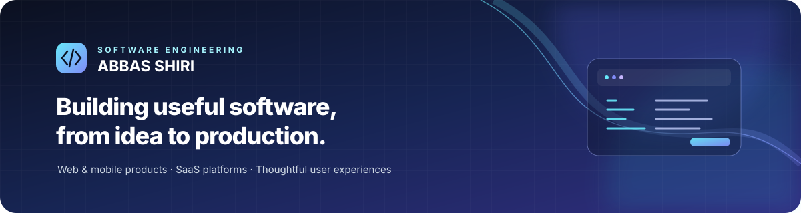

  

<h2 align="center">Full-stack developer · SaaS · Web & mobile</h2>

I build practical software products end to end: responsive interfaces, API-connected workflows, data-backed features, authentication, and mobile delivery.

  
  

## About

I work across frontend and backend boundaries, with an emphasis on complete user journeys rather than isolated screens. My focus includes product UX, API integration, authentication, database-backed workflows, localization, maintainable architecture, and evidence-based testing.

I am currently developing two independent products for different audiences.

## Selected products

<table>
  <tr>
    <td width="50%" valign="top">
      <h3><a href="https://github.com/wondxpt/Xperslot-Showcase">XperSlot</a></h3>
      
<strong>Primary product · Service booking and business operations SaaS</strong>

      
XperSlot is organised as two dedicated apps:

      <ul>
        <li><strong>Customer:</strong> discover providers, compare services, make appointments, and manage bookings.</li>
        <li><strong>Business:</strong> manage services, availability, calendars, teams, clients, and customer communication.</li>
      </ul>
      
React · TypeScript · Node.js · Supabase · PostgreSQL · Android

      
<a href="https://github.com/wondxpt/Xperslot-Showcase">Product overview and conceptual architecture</a>

      
<a href="https://github.com/wondxpt/XperSlot-Downloads">Official Android app and release status</a>

      
The current product direction is the separate Customer and Business apps. Public APK distribution will be announced after the exact release binaries and upgrade path are verified.

    </td>
    <td width="50%" valign="top">
      <h3><a href="https://github.com/wondxpt/ResuMetrics">ResuMetrics</a></h3>
      

      
<strong>Resume and CV builder · Web and Android</strong>

      
A resume editor with multiple layouts, live preview, resume-quality helpers, localization, right-to-left support, and PDF output.

      
React · Vite · Zustand · Capacitor · Android Print Framework

      
<a href="https://github.com/wondxpt/ResuMetrics">Source code, implementation notes, and testing guidance</a>

      
<a href="https://github.com/wondxpt/ResuMetrics/releases/tag/v1.0.1-beta">Android beta release notes</a>

    </td>
  </tr>
</table>

## Engineering focus

- **End-to-end product delivery:** connect UI, API, persistence, permissions, and failure states into coherent workflows.
- **Reliable data flows:** pay attention to tenant boundaries, authentication, booking state, and data consistency.
- **Web and mobile UX:** build responsive interfaces and account for localization and right-to-left layouts.
- **Practical validation:** use automated tests, CI, build checks, and device smoke tests while distinguishing verified behavior from work still in progress.

## Technology

  
  
  
  
  
  
  
  
  

**Areas of work:** React and TypeScript · Node.js APIs · SaaS workflows · PostgreSQL and Supabase · Authentication · Android delivery · PDF generation · Localization and RTL · Automated testing

## Collaboration

I am open to relevant remote, project-based work and product collaborations involving frontend development, React/TypeScript applications, API integration, dashboards, and practical full-stack features.

For project discussions, please include the problem, preferred stack, expected deliverables, and target timeline.

## Contact

- [LinkedIn](https://www.linkedin.com/in/abbas-shiri-453690248/)
- [GitHub repositories](https://github.com/wondxpt?tab=repositories)

Building useful software, one verified iteration at a time.

